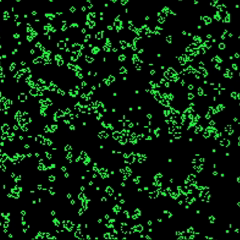
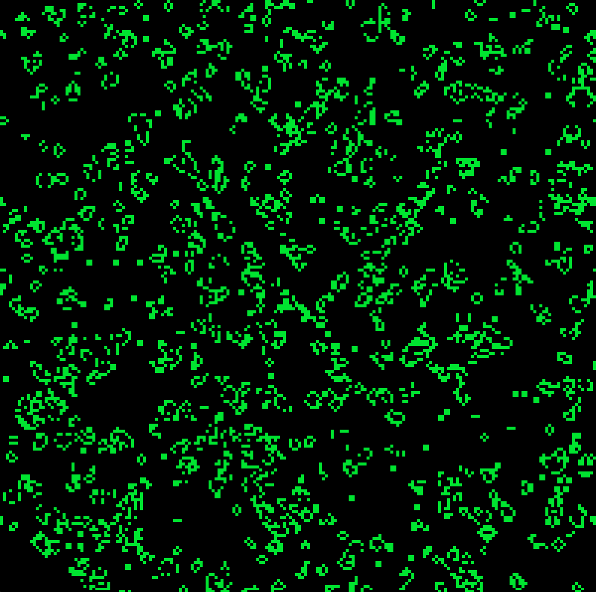
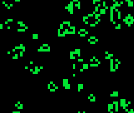

# Conway's Game of Life

**This is an implementation of Conway's Game of Life built in C++ using the raylib library, it is a zero player game based on a grid where a cell can either be alive (1) or dead (0), the cells update step by step based on a set of rules**

## How to run the game
**1. On the repository page, go to the releases and download the `.exe` file.**

**2. Double-click the `.exe` file to launch the game.**

## Rules of Life

* **Underpopulation:** A live cell with fewer than 2 live neighbors dies.
* **Survival:** A live cell with 2 or 3 live neighbors stays alive.
* **Overpopulation:** A live cell with more than 3 live neighbors dies.
* **Reproduction:** A dead cell with exactly 3 live neighbors becomes alive.

## About this specific project

* **The game is set to run at 12 Frames per second**
* **Every cell has 25% chance to be alive(1) when the game starts**
* **The game has a window resolution of 1000x1000**
* **The grid is of 100x100 cells**
* **Each cell has 10 pixel height and 10 pixel width**
* **Alive(1) cells are drawn in GREEN**
  
  ## Preview

  **Game of life in action**
  
  

  ## Snapshots from the Game
  **Full snapshot**
  
  **Close-up snapshot**
  
